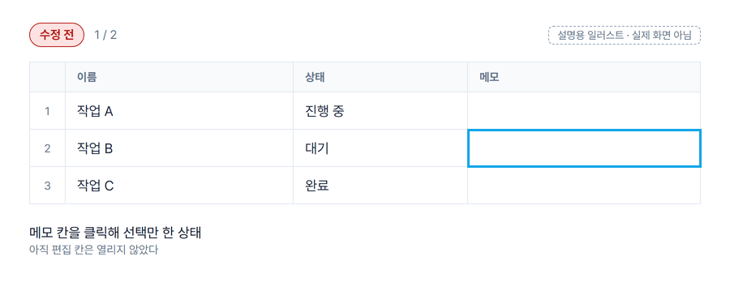

# airtable-korean-ime-fix

> 에어테이블에서 셀을 선택한 뒤 바로 한글을 치면 첫 글자가 영문으로 들어가는 문제를, **편집 모드 진입 키(F2)를 먼저 보내는** 방식으로 막는 AutoHotkey v2 스크립트입니다.

*English summary is at the [bottom](#english-summary).*




*설명용 일러스트입니다. 실제 에어테이블 화면을 녹화한 것이 아니라, 동작 원리를 보여 주려고 단순화한 표 그림입니다.*

## 문제 (증상)

- 에어테이블 표에서 셀을 **클릭해 선택만 한 상태**에서 곧바로 한글을 치면, 첫 자모가 영문으로 들어갑니다.
  - 예: `한글`(키 G K S R M F)을 치면 `gㅏㄴ글`처럼 첫 글자가 `g`로 새고 나머지 조합이 깨집니다.
- 그래서 매번 셀을 더블클릭하거나 Enter로 편집 칸을 연 뒤에 입력해야 합니다. 칸을 많이 채우는 작업일수록 이 한 번의 동작이 계속 쌓입니다.
- 영문은 문제가 없고, 한글처럼 **입력기(IME)가 글자를 조합하는 언어**에서만 생깁니다.


## 원리

셀이 "선택만 된" 상태에서 글자 키가 눌리면, 스크립트가 그 키를 잠깐 붙잡고 **F2를 먼저 보내 편집 칸을 연 다음 원래 키를 다시 보냅니다.** 편집 칸이 이미 열려 있는 상태에서 키가 들어가므로 입력기가 첫 글자부터 정상적으로 조합합니다.


- **건드리지 않는 키:** Ctrl·Alt·Win 조합(단축키), 방향키, Enter·Esc·Tab, 숫자·기호·스페이스. 가로채는 키는 글자 키 A~Z(Shift 포함)뿐입니다.
- **이미 편집 중이면 개입하지 않습니다.** 편집 중인지는 화면을 읽지 않고 누른 키와 클릭으로 추정합니다([편집 상태 추정 규칙](docs/how-it-works.md#편집-상태를-어떻게-아나)).
- **영문 입력 상태에서는 개입하지 않습니다**(설정으로 바꿀 수 있음).
- 자세한 설명: [docs/how-it-works.md](docs/how-it-works.md)

## 설치 (3단계)

1. **AutoHotkey v2 설치** — 공식 사이트 [autohotkey.com](https://www.autohotkey.com/)에서 *Download → v2.0*을 받아 설치합니다. (이 저장소에는 설치 파일을 넣지 않았습니다.)
2. **스크립트 받기·실행** — [Releases](https://github.com/workzeroai/airtable-korean-ime-fix/releases/latest)에서 `airtable-korean-ime-fix.ahk`(또는 zip)를 받아 원하는 폴더에 두고 더블클릭합니다. 작업 표시줄 오른쪽 트레이에 초록색 **H** 아이콘이 생기면 실행 중입니다.
3. **자동 실행 등록(선택)** — 트레이 아이콘 우클릭 → **Windows 시작 시 자동 실행**을 체크합니다. 다음부터 Windows가 켜질 때 자동으로 실행됩니다.

## 사용

설치 후에는 평소처럼 에어테이블에서 셀을 클릭하고 바로 한글을 치면 됩니다. 트레이 아이콘을 우클릭하면 아래 메뉴가 있습니다.

| 메뉴 | 하는 일 |
|---|---|
| 한글 입력 보정 사용 | 체크 = 켜짐, 해제 = 꺼짐(스크립트는 실행 중이지만 아무 키도 가로채지 않음). 트레이 아이콘 더블클릭으로도 전환 |
| Windows 시작 시 자동 실행 | 시작 프로그램 폴더에 바로가기를 만들거나 지웁니다(관리자 권한 불필요) |
| 종료 | 스크립트를 끝냅니다 |

설정은 `airtable-korean-ime-fix.ahk` 맨 위 상수에서 바꿉니다(메모장으로 열어 수정 → 저장 → 다시 실행).

| 상수 | 기본값 | 설명 |
|---|---|---|
| `BROWSER_EXES` | `chrome.exe`, `msedge.exe` | 대상 브라우저. 창 제목에 `TITLE_KEYWORD`가 있어야 동작 |
| `TITLE_KEYWORD` | `Airtable` | 브라우저 탭(창) 제목에서 찾을 글자 |
| `DESKTOP_APP_EXES` | `Airtable.exe` | 데스크톱 앱 실행 파일 이름 |
| `F2_DELAY_MS` | `40` | F2 뒤 원래 키를 보내기까지 기다리는 시간(ms). 첫 글자가 여전히 새면 60~100으로 |
| `ONLY_WHEN_HANGUL` | `true` | 한글 입력 상태일 때만 개입 |
| `START_ENABLED` | `true` | 실행 직후 켜진 상태로 시작 |
| `TOGGLE_HOTKEY` | `""` | 켜기/끄기 단축키(예: `"^!h"` = Ctrl+Alt+H). 빈 값이면 없음 |

## 지원 환경

| 항목 | 대상 |
|---|---|
| 운영체제 | Windows 10 / 11 (시작 단계 확인은 Windows 11에서만 함) |
| 런타임 | AutoHotkey **v2.0** 이상(v1에서는 실행되지 않음) |
| 브라우저 | Chrome, Edge — 에어테이블 탭이 **활성 탭**이고 창 제목에 `Airtable`이 있을 때 |
| 데스크톱 앱 | 에어테이블 Windows 앱(실행 파일 `Airtable.exe` 기준) |
| 입력기 | Windows 기본 한국어 입력기(두벌식 기준으로 설명) |

## 테스트 상태

**확인한 것 (2026-10-13, AutoHotkey 2.0.22, Windows 11)**

- [x] 문법 검사: `AutoHotkey64.exe /Validate` 통과, `#Warn All`을 켠 상태에서도 경고 0건
- [x] 시작 단계 실행: 스크립트가 오류 없이 시작되고 트레이 메뉴(4항목)와 핫키가 등록되는 것을 확인(에어테이블이 아닌 창에서 실행 후 자동 종료하는 별도 사본으로 확인)

**사용자 확인 필요 (실제 에어테이블에서는 아직 확인하지 않았습니다)**

- [ ] Chrome·Edge 에어테이블 탭에서 셀 선택 후 한글을 바로 칠 때 첫 글자가 정상 입력되는지
- [ ] 에어테이블에서 F2가 편집 칸을 여는지, 값이 있는 셀에서 **덮어쓰기/이어 쓰기** 중 어느 쪽이 되는지
- [ ] 데스크톱 앱의 실행 파일 이름이 `Airtable.exe`가 맞는지(작업 관리자 → 세부 정보)
- [ ] 빠르게 이어 칠 때 글자 순서가 바뀌지 않는지
- [ ] Ctrl+C/V/Z, 방향키, Enter·Esc·Tab이 평소대로 동작하는지
- [ ] 검색창·댓글·레코드 펼침 창 등 **셀이 아닌 입력란**에서 부작용이 없는지
- [ ] 영문 입력 상태에서는 개입하지 않는지(한글 상태 감지)
- [ ] 트레이 메뉴의 켜기/끄기, 시작 프로그램 등록·해제

## 알려진 한계 · 끄는 법

**한계**

- 스크립트는 웹 페이지 안을 읽지 못합니다. **편집 중인지는 누른 키와 클릭으로 추정**하므로 실제 상태와 어긋날 수 있습니다. 어긋났다 싶으면 **Esc**를 한 번 누르면 "선택 상태"로 다시 맞춰집니다.
- 편집 중인 셀 안을 한 번 클릭하면 "선택 상태"로 판단해, 다음 글자 앞에 F2가 한 번 더 갈 수 있습니다.
- 셀이 아닌 입력란(검색창, 댓글 등)에 커서가 있어도 같은 탭 안이라면 첫 글자 앞에 F2가 갈 수 있습니다. 보통 웹 입력란에서 F2는 아무 동작도 하지 않지만, 확인이 필요합니다.
- 브라우저는 **창 제목**으로 대상을 고릅니다. 에어테이블 탭이 활성 탭이 아니면 동작하지 않고, 다른 사이트라도 제목에 `Airtable`이 있으면 동작합니다.
- 키 입력을 다시 보내는 방식이라 다른 키 매핑 프로그램(다른 AutoHotkey 스크립트 등)과 겹치면 충돌할 수 있습니다.
- 회사 보안 정책으로 AutoHotkey 실행이 막힌 PC에서는 쓸 수 없습니다.

**끄는 법**

- 잠깐 끄기: 트레이 아이콘 우클릭 → **한글 입력 보정 사용** 체크 해제(또는 트레이 아이콘 더블클릭)
- 완전히 끝내기: 트레이 아이콘 우클릭 → **종료**
- 자동 실행 해제: 트레이 메뉴에서 **Windows 시작 시 자동 실행** 체크 해제. 스크립트를 이미 지웠다면 `Win+R` → `shell:startup` 폴더에서 `airtable-korean-ime-fix.lnk`를 지웁니다.

## 저장소 구성

```text
airtable-korean-ime-fix/
├─ airtable-korean-ime-fix.ahk   # 스크립트 본체(설정은 맨 위 상수)
├─ docs/how-it-works.md          # 원인과 해결 원리
├─ assets/
│  ├─ banner.png
│  ├─ diagrams/                  # 도면: .yaml(사양) .excalidraw .excalidraw.md .svg .png
│  └─ illustration/              # 수정 전/후 설명용 일러스트(GIF·PNG)
├─ CHANGELOG.md
└─ LICENSE
```

도면은 [Excalidraw](https://excalidraw.com/)에서 `.excalidraw` 파일을 열어 고칠 수 있습니다.

## English summary

**airtable-korean-ime-fix** is a small AutoHotkey v2 script for Windows. In Airtable, if you select a cell and immediately start typing Korean, the first keystroke is entered as a Latin letter (e.g. typing `한글` gives `gㅏㄴ글`), because the cell editor opens on that first key before the IME starts composing. When a letter key (A–Z) is pressed while a cell is only *selected*, the script first sends **F2** to open the cell editor, waits briefly (40 ms by default), then re-sends the original key so the IME composes correctly from the first character. Shortcuts (Ctrl/Alt/Win), arrows, Enter/Esc/Tab, digits and symbols are never intercepted. It works in Chrome/Edge tabs whose title contains "Airtable" and in the Airtable desktop app, and has a tray menu to toggle it, register it at Windows startup, and exit.

*Status:* syntax-checked with AutoHotkey 2.0.22 (`/Validate`) and start-up tested; **not yet verified inside Airtable** — see the checklist above. Requires AutoHotkey v2 from [autohotkey.com](https://www.autohotkey.com/) (not bundled). Not affiliated with Airtable.

---

Airtable은 Airtable의 상표이며, 이 프로젝트는 Airtable과 관련이 없는 개인 도구입니다.

MIT © workzeroai
