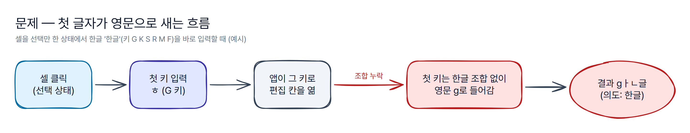
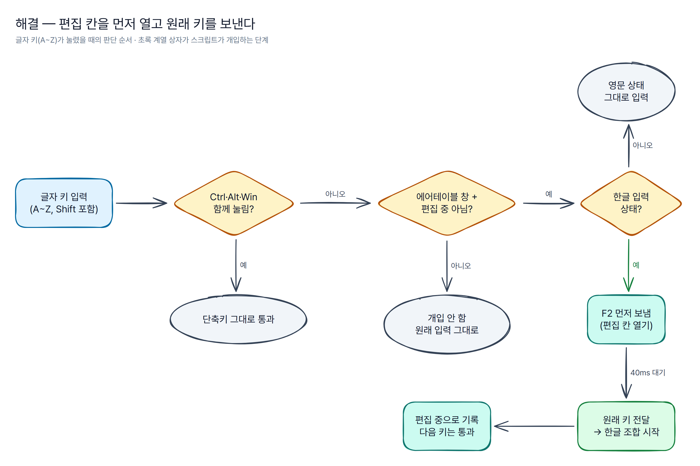
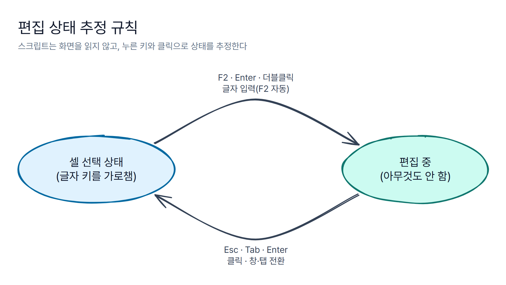

# 어떻게 동작하나

[← README로 돌아가기](../README.md)

## 1. 한글 입력은 "조합"을 거친다

영문은 키 하나가 곧 글자 하나입니다. `g`를 누르면 `g`가 바로 들어갑니다.

한글은 다릅니다. Windows의 한국어 입력기(IME)는 키를 받아 **자모를 모아 글자를 조합**합니다.

| 누른 키 | G | K | S | R | M | F |
|---|---|---|---|---|---|---|
| 자모 | ㅎ | ㅏ | ㄴ | ㄱ | ㅡ | ㄹ |
| 화면 | ㅎ | 하 | 한 | 한ㄱ | 한그 | 한글 |

조합은 **입력을 받을 칸(편집 칸)에 커서가 있을 때** 시작됩니다. 입력기는 그 칸 안에 조합 중인 글자를 보여 주다가, 글자가 완성되면 확정해서 넘깁니다.

## 2. 셀을 "선택만" 한 상태에서는 편집 칸이 없다

에어테이블 같은 표 화면에서 셀을 한 번 클릭하면 셀에 테두리만 생깁니다. 이때는 아직 **편집 칸이 열리지 않은 상태**입니다. 이 상태에서 글자 키를 누르면 앱이 그 키를 보고 편집 칸을 열고, 그 키를 첫 글자로 넣어 줍니다(이른바 "입력하면 바로 편집").

영문이라면 문제가 없습니다. 하지만 한글은 첫 키가 들어오는 순간 아직 편집 칸이 없으므로:

1. 첫 키(G)는 입력기의 조합을 거치지 못하고 **영문 `g` 그대로** 앱에 전달되고,
2. 앱이 그 `g`로 편집 칸을 연 뒤에야 다음 키(K, S, …)부터 조합이 시작됩니다.
3. 첫 자음(ㅎ)을 잃은 나머지 키는 `ㅏ`, `ㄴ`처럼 낱자로 남기 쉬워, 결과가 `gㅏㄴ글`처럼 깨집니다.

> 위 순서는 이 증상을 설명하는 일반적인 모델입니다. 앱 내부 구현을 직접 확인한 것은 아니며, 정확한 결과 글자는 상황에 따라 다를 수 있습니다.

## 3. 해결: 편집 칸을 먼저 열고, 원래 키를 다시 보낸다

문제의 핵심은 **"첫 키가 들어올 때 편집 칸이 없다"** 는 점입니다. 그래서 순서를 바꿉니다.

1. 셀 선택 상태에서 글자 키가 눌리면 스크립트가 그 키를 **잠깐 붙잡습니다**(앱에 전달하지 않음).
2. 편집 모드 진입 키 **F2**를 먼저 보내 편집 칸을 엽니다.
3. 편집 칸이 열리고 커서가 들어갈 시간을 조금(기본 40ms) 기다립니다.
4. 붙잡아 둔 **원래 키를 다시 보냅니다.** 이제 편집 칸이 있으므로 입력기가 첫 자모부터 조합합니다.
5. 이후 키는 "편집 중"으로 보고 건드리지 않습니다.

### 건드리지 않는 키

- **Ctrl·Alt·Win 조합**: 스크립트는 "수식키 없이" 또는 "Shift만" 누른 글자 키에만 반응하도록 등록돼 있어, 단축키는 처음부터 가로채지 않습니다.
- **방향키, Enter, Esc, Tab, F2**: 가로채지 않고 지켜보기만 하면서(아래 "편집 상태" 추정에 사용) 그대로 앱에 넘깁니다.
- **숫자·기호·스페이스**: 한글 입력기가 조합하지 않는 키라 이 문제가 생기지 않으므로 손대지 않습니다.

### 영문 상태에서는 개입하지 않는다

`ONLY_WHEN_HANGUL = true`(기본)이면, 키를 붙잡았을 때 현재 입력기가 한글 상태인지 Windows에 물어봅니다(IME 변환 모드의 "한글" 비트). 영문 상태라면 F2 없이 원래 키만 그대로 보냅니다. 입력기 상태를 확인할 수 없는 경우에는 증상 해결을 우선해 개입합니다.

### 빠르게 이어 쳐도 순서가 지켜지는 이유

F2를 보내고 기다리는 동안 사용자가 다음 키를 칠 수 있습니다. 스크립트는 이 처리를 **끼어들 수 없는 구간(Critical)** 으로 실행하므로, 그 사이에 눌린 키는 대기열에 쌓였다가 첫 키를 보낸 뒤에 차례대로 처리됩니다. 이때는 이미 "편집 중"이므로 F2 없이 그대로 전달됩니다.

## 편집 상태를 어떻게 아나

AutoHotkey는 웹 페이지 안(어떤 셀이 편집 중인지)을 읽을 수 없습니다. 그래서 **누른 키와 클릭으로 상태를 추정**합니다.

| 사건 | 추정 상태 | 이유 |
|---|---|---|
| 스크립트가 F2 + 글자를 보냄 | 편집 중 | 방금 편집 칸을 열었음 |
| 사용자가 F2를 누름 | 편집 중 | F2는 편집 모드 진입 키 |
| 더블클릭 | 편집 중 | 셀 더블클릭은 편집 시작 |
| Enter | 뒤집기 | 선택 상태의 Enter는 편집 시작, 편집 중 Enter는 확정 |
| Esc, Tab, Shift+Tab | 선택 상태 | 편집 취소·확정 후 이동 |
| 한 번 클릭 | 선택 상태 | 다른 셀을 고른 것으로 봄 |
| 다른 창·탭으로 이동(창 제목이 바뀜) | 선택 상태 | 처음부터 다시 추정 |

추정이 실제와 어긋나는 대표적인 경우와 대처는 README의 [알려진 한계](../README.md#알려진-한계--끄는-법)에 있습니다. 어긋났다 싶으면 **Esc**를 한 번 누르면 "선택 상태"로 맞춰집니다.

## 대상 창을 고르는 방법

- 브라우저(`chrome.exe`, `msedge.exe`): 활성 창의 제목에 `Airtable`이 들어 있을 때만 동작합니다. 브라우저 창 제목은 활성 탭의 제목을 따릅니다.
- 데스크톱 앱(`Airtable.exe`): 창 제목과 관계없이 동작합니다.
- 그 밖의 모든 프로그램에서는 아무 키도 가로채지 않습니다.

## 왜 F2인가

표 계산 프로그램에서 F2는 오래전부터 "선택한 셀을 편집 모드로 열기" 키로 쓰여 왔고, 이 도구는 에어테이블에서도 F2가 같은 역할을 한다는 전제로 만들었습니다. 사용하는 환경에서 F2가 다르게 동작한다면(예: 값이 있는 셀에서 덮어쓰기 대신 이어 쓰기가 되는 등) README의 [테스트 상태](../README.md#테스트-상태)에 있는 항목으로 확인해 주세요.
